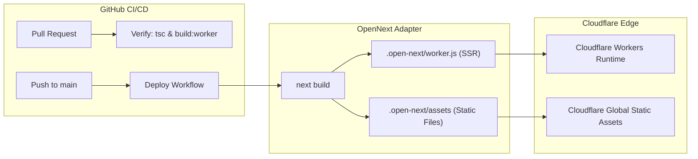

# Cloudflare Server-Side Rendering (SSR) & CI/CD Deployment Guide

This document describes OpenLearn's Server-Side Rendering (SSR) and edge deployment architecture on Cloudflare Workers, integrated with Next.js 15 App Router and GitHub Actions.

---

## 1. Architecture Overview

OpenLearn uses the **OpenNext Cloudflare adapter** (`@opennextjs/cloudflare`) to execute Next.js 15 App Router applications on Cloudflare Workers with native static asset acceleration.



### Key Architectural Characteristics
- **Free-Tier Optimization**: Static assets (HTML, CSS, JS bundles, images) are served through Cloudflare's global static asset cache at zero compute charge.
- **Dynamic & Edge SSR**: Dynamic routes and server actions execute within Cloudflare Workers with `nodejs_compat` runtime compatibility.
- **Deterministic CI/CD**: Every push to `main` and Pull Request validates the build graph through GitHub Actions.

---

## 2. Configuration Files

| File | Purpose |
|---|---|
| [`wrangler.jsonc`](../wrangler.jsonc) | Defines Worker name, entry point (`.open-next/worker.js`), `nodejs_compat` flag, and assets binding (`.open-next/assets`). |
| [`open-next.config.ts`](../open-next.config.ts) | OpenNext adapter configuration for Cloudflare overrides (R2 cache, edge bindings). |
| [`next.config.ts`](../next.config.ts) | Next.js configuration for transpilation and remote image patterns. |
| [`.github/workflows/deploy-cloudflare.yml`](../.github/workflows/deploy-cloudflare.yml) | Automated CI/CD pipeline for verification and Cloudflare deployment. |

---

## 3. GitHub Secrets Configuration

To enable automated deployments from the `main` branch, configure the following secrets in **GitHub Repository Settings $\rightarrow$ Secrets and variables $\rightarrow$ Actions**:

| Secret Name | Description | Required Permissions |
|---|---|---|
| `CLOUDFLARE_API_TOKEN` | Cloudflare API Token | **Edit Cloudflare Workers** template |
| `CLOUDFLARE_ACCOUNT_ID` | Cloudflare Account ID | Visible in your Cloudflare dashboard overview URL |

---

## 4. Local Commands

```bash
# Standard local Next.js development server
npm run dev

# Standard Next.js production build
npm run build

# Build Next.js app and package into Cloudflare Worker bundle
npm run build:worker

# Preview the Cloudflare Worker locally (Miniflare/Wrangler runtime)
npm run preview

# Deploy manually using local Wrangler credentials
npm run deploy

# Generate TypeScript definitions for Cloudflare bindings
npm run cf-typegen
```
