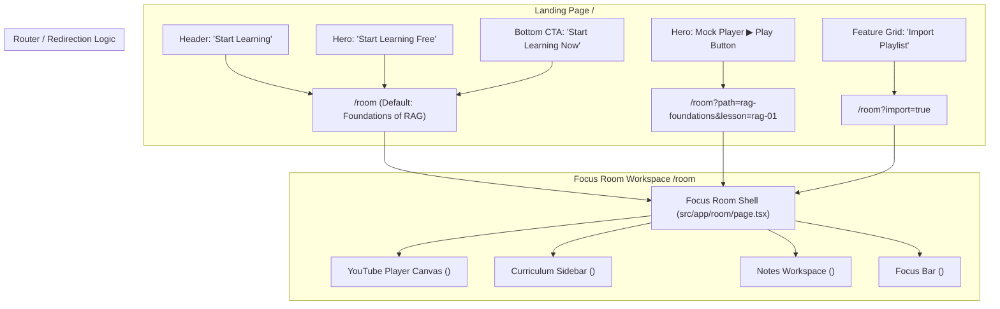

# FEATURE SPECIFICATION: PHASE 1 FOCUS ROOM & PLAYER ENGINE

**Specification ID:** SPEC-0002  
**Feature:** Phase 1 Foundation: Distraction-Free Focus Room, YouTube Player & Redirection Architecture  
**Status:** Draft / Ready for Implementation  
**Target Route:** `/room`  
**Primary Owner:** Core Engineering (`@SriSatyaLokesh`, `@scc4287`)  
**Parent Document:** [`docs/OPENLEARN_PRD.md`](../../docs/OPENLEARN_PRD.md) (Section 15: Focus Room, Section 14: Content Adaptation)  
**Related ADRs:**  
- [`docs/ADR/0006-youtube-provider-contract.md`](../../docs/ADR/0006-youtube-provider-contract.md) *(YouTube IFrame Provider Contract & Compliance)*  
- [`docs/ADR/0007-guest-mode.md`](../../docs/ADR/0007-guest-mode.md) *(Guest-First Continuity & Anonymous Auth Seam)*  
- [`docs/ADR/0001-hosting-and-rendering.md`](../../docs/ADR/0001-hosting-and-rendering.md) *(SSR vs. Client Boundaries)*  
- [`docs/ADR/0005-repo-structure.md`](../../docs/ADR/0005-repo-structure.md) *(Domain Boundary Isolation)*  

---

## 1. Objective & Scope

### 1.1 The Core Problem
Online learners encounter overwhelming cognitive friction on standard video platforms:
1. **Algorithmic Attention Traps:** Video recommendations, notifications, and infinite feeds siphon focus away from study intent.
2. **Scattered Context:** Notes are taken in separate apps (Notion, Obsidian, scratchpads), disconnecting insights from the exact video timestamp.
3. **Zero Completion Structure:** Multi-part video courses lack prerequisite tracking, checkmarks, or clear resume points, resulting in a 97% abandon rate.

### 1.2 The Solution
Deliver **Phase 1: Foundation (Core Focus Engine)** as defined in [`README.md`](../../README.md):
- A distraction-free study environment at `/room` connected directly to the landing page.
- An official YouTube IFrame player engine operating under strict compliance with YouTube Terms of Service.
- A smart URL and playlist ingestion parser for instant course setup.
- A timestamped Markdown note-taking panel synchronized with playback seconds.
- Local storage continuity preserving resume position, notes, and module progress without requiring mandatory authentication.

### 1.3 Scope Boundaries & Non-Goals
| In Scope (Phase 1) | Out of Scope (Deferred to Future Phases) |
|---|---|
| Direct redirection from landing page CTAs to `/room` | User auth via OAuth / Email (Deferred to Phase 1.5 / Phase 2) |
| YouTube video and playlist URL ingestion | AI quiz generation / LLM question extraction |
| Synchronized YouTube IFrame playback | Community learning path directory & search |
| Timestamped notes with click-to-seek | Forking, social sharing, and learner profiles |
| Markdown preview and `.md` file export | Audio-only/ambient playback (**Strict Non-Goal per ADR-0006**) |
| Guest mode state persistence via `localStorage` | Cloud database synchronization |

---

## 2. Redirection & User Journey Architecture

The landing page (`/`) serves as the top-of-funnel conversion engine, funneling users into the Focus Room:



### 2.1 Route & Query Parameter Contract
- **`/room`**: Initializes the Focus Room with the benchmark curriculum (*Foundations of RAG*, 6 curated modules).
- **`/room?path=[path-slug]`**: Loads a specific bundled learning path.
- **`/room?url=[encoded-url]`**: Parses user-pasted YouTube video or playlist URL directly into an ad-minimized focus session.
- **`/room?import=true`**: Automatically triggers the URL/Playlist Importer modal on mount.

---

## 3. Information Architecture & Workspace Layout

The Focus Room layout implements an ergonomic, split-workspace grid built with the TasteSkill editorial aesthetic:

```text
+----------------------------------------------------------------------------------------------------+
|  [⚡ OPENLEARN]  Foundations of RAG > 02 Dense Vectors   [Import URL]  [⏱ 25:00]  Progress: 33%  [Save] |
+-------------------------------------------------------------+--------------------------------------+
|                                                             | [Queue]   [Notes (3)]   [Summary]    |
|                                                             |--------------------------------------|
|                     YOUTUBE IFRAME CANVAS                   | 01. What is RAG?           ✓ 12:40   |
|                                                             | 02. Dense Vectors & Embed  ▶ 18:25   |
|             (Official IFrame API - Push Layout)             | 03. Vector Indexing        ○ 22:10   |
|                                                             | 04. Retrieval Mechanics    ○ 19:45   |
|                                                             | 05. Generation & Grounding ○ 25:10   |
|                                                             | 06. Production Benchmarks  ○ 16:30   |
+-------------------------------------------------------------+--------------------------------------+
| [⏮ Prev] [▶ Play/Pause] [⏭ Next]  10:14 / 18:25  [1.0x] [🔊] |  [+ Stamp Note @ 10:14]  [Export .md] |
|                                                             |  • 04:12 Cosine similarity intuition |
| Keyboard: Space=Toggle | J/L=±10s | N=Note | F=Theater      |  • 08:45 Embedding dimension trade-off|
+-------------------------------------------------------------+--------------------------------------+
```

### 3.1 Component Hierarchy (`src/components/room/`)
```text
src/components/room/
├── FocusRoomShell.tsx       # Top-level workspace layout & state provider
├── FocusPlayer.tsx          # YouTube IFrame wrapper & playback event broker
├── PathQueue.tsx            # Curriculum lesson drawer & progress indicator
├── NotesPanel.tsx           # Timestamped markdown notes editor & preview
├── PomodoroBar.tsx          # Lightweight 25/5 study session timer
├── UrlImportModal.tsx       # Client-side YouTube URL / playlist parser modal
└── index.ts                 # Clean barrel export
```

---

## 4. YouTube IFrame API Provider Contract (ADR-0006 Compliance)

To guarantee compliance with YouTube Terms of Service and API policies:

1. **Official IFrame Embedding:** Must use `https://www.youtube.com/iframe_api`. Raw video streaming (`.mp4`, `.m3u8`), reverse-engineered Decipher extraction, or scraping is strictly forbidden.
2. **Push-Layout Architecture (No Occlusion):** Floating modals, tooltips, or overlays must NEVER render on top of the active YouTube video player area. Modals render as dimming overlays with player pause, or shift the layout outward.
3. **Zero Audio-Only / Background Playback:** The video element is never minimized into an audio-only background task or hidden playback stream.
4. **Direct Asset Hotlinking:** Video thumbnails link directly to `https://i.ytimg.com/vi/{videoId}/hqdefault.jpg` without caching or local redistribution.
5. **Branding & Attributions:** Original channel titles, video titles, and YouTube controls/links remain intact and directly accessible.

---

## 5. Data Contracts & Type Definitions (`src/types/room.ts`)

```typescript
/**
 * Core domain contracts for Phase 1 Focus Room.
 */

export interface LessonNode {
  id: string;
  stepNumber: string;
  title: string;
  videoId: string;
  durationSeconds: number;
  durationLabel: string;
  creator: string;
  creatorChannelUrl?: string;
  summary: string;
  completed: boolean;
}

export interface LearningPathSession {
  id: string;
  title: string;
  description: string;
  sourceType: 'curated' | 'imported_playlist' | 'single_video';
  lessons: LessonNode[];
  activeLessonId: string;
  progressPercent: number;
  lastUpdated: number;
}

export interface TimestampedNote {
  id: string;
  lessonId: string;
  timestampSeconds: number;
  timestampLabel: string; // e.g., "04:15"
  content: string;
  createdAt: number;
}

export interface PlayerControlsState {
  isPlaying: boolean;
  currentTimeSeconds: number;
  durationSeconds: number;
  playbackRate: number; // 0.75, 1, 1.25, 1.5, 2
  volume: number;
  isMuted: boolean;
  theaterMode: boolean;
}

export interface ImportParseResult {
  valid: boolean;
  type: 'video' | 'playlist' | 'unknown';
  videoId?: string;
  playlistId?: string;
  originalUrl: string;
  error?: string;
}
```

---

## 6. Persistence & Guest Mode State Machine (ADR-0007)

Phase 1 provides complete functionality without requiring an account:

### 6.1 Local Storage Schema
- **Key:** `openlearn_focus_session_v1`
- **Data Payload:**
  ```json
  {
    "activePathId": "rag-foundations",
    "activeLessonId": "rag-02",
    "resumeTimes": {
      "rag-01": 760,
      "rag-02": 614
    },
    "completedLessonIds": ["rag-01"],
    "notes": [
      {
        "id": "note_101",
        "lessonId": "rag-02",
        "timestampSeconds": 252,
        "timestampLabel": "04:12",
        "content": "Cosine similarity formula: dot product over magnitude product.",
        "createdAt": 1728567890
      }
    ],
    "pomodoro": {
      "mode": "focus",
      "remainingSeconds": 1240
    }
  }
  ```

### 6.2 Anonymous Auth Seam
All `localStorage` storage functions are wrapped behind a generic storage adapter interface (`StorageAdapter`), allowing seamless hydration into Supabase RLS profiles in Phase 2 without rewriting UI components.

---

## 7. UI/UX & Ergonomic Tokens

The Focus Room adheres to the **TasteSkill Tactile Editorial** design system:
- **Canvas:** `#F5F4F0` warm paper background.
- **Player Container:** `#0A0A0A` deep charcoal theater shell for maximum contrast and focus.
- **Accents:** `#FF5226` electric orange active track markers, playhead highlights, and primary triggers.
- **Typography:**
  - `Outfit`: Navigation, controls, tabs, and button labels.
  - `Newsreader`: Editorial italic section quotes and module notes.
  - `JetBrains Mono`: Playback timecode counters (`04:12 / 18:25`) and keyboard shortcut badges.
- **Keyboard Shortcuts:**
  - `Space` / `K`: Play / Pause toggle.
  - `J` / `L`: Seek backward / forward 10 seconds.
  - `N`: Create new timestamped note at current playback second.
  - `F`: Toggle full-width theater mode (collapses sidebar).
  - `M`: Toggle mute.

---

## 8. Acceptance Criteria (ACs)

- [ ] **AC-1 (Landing Page Redirection):** Clicking "Start Learning" in `HeaderNav`, `HeroSection`, and `BottomCta` navigates directly to `/room`.
- [ ] **AC-2 (Zero-Occlusion YouTube Player):** YouTube IFrame loads via the official API without any floating modals occluding video playback.
- [ ] **AC-3 (Curriculum Queue Navigation):** Selecting a lesson in the queue switches the active video, updates breadcrumbs, and updates the active progress state.
- [ ] **AC-4 (Timestamped Note Creation):** Clicking "Timestamp Note" (or pressing `N`) captures the exact video playback second (`MM:SS`) and focuses the note input.
- [ ] **AC-5 (Click-to-Seek):** Clicking a timestamp badge on any saved note automatically seeks the YouTube player to that exact playback second.
- [ ] **AC-6 (Markdown Preview & Export):** Notes render markdown styling and support one-click copy to clipboard and `.md` file download.
- [ ] **AC-7 (URL & Playlist Ingestion):** Pasting a standard YouTube video URL (`youtu.be/...` or `youtube.com/watch?v=...`) or playlist URL (`...list=...`) successfully extracts IDs and updates the player.
- [ ] **AC-8 (Session Continuity & Resume):** Refreshing the page or revisiting `/room` restores the user's active lesson, playback timestamp, and saved notes from `localStorage`.
- [ ] **AC-9 (Ergonomic Keyboard Shortcuts):** Keyboard hotkeys (`Space`, `J`, `L`, `N`, `F`) work seamlessly without interfering with text inputs.
- [ ] **AC-10 (TasteSkill Compliance):** Design tokens match `#F5F4F0` paper canvas, `#0A0A0A` charcoal frame, `#FF5226` orange accents, and `Outfit`/`JetBrains Mono` fonts.
- [ ] **AC-11 (Mobile Responsive Layout):** Below 1024px viewport width, the layout stacks the player above tabbed queue and notes views.
- [ ] **AC-12 (Build & Typecheck Cleanliness):** Passes `tsc --noEmit` and `next build` with zero errors.
