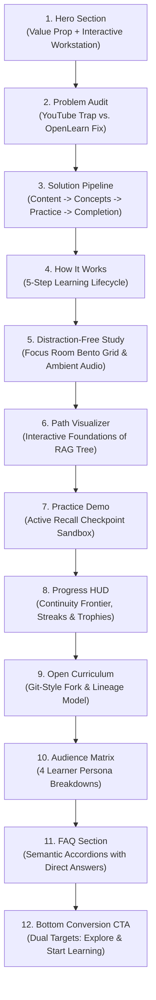

# FEATURE SPECIFICATION: OPENLEARN LANDING PAGE

**Specification ID:** SPEC-0001  
**Feature:** OpenLearn Public Landing Page & Interactive Showcase  
**Status:** Implemented  
**Target Route:** `/`  
**Primary Owner:** Frontend Engineering (`@SriSatyaLokesh`, `@scc4287`)  
**Parent Document:** [`docs/OPENLEARN_PRD.md`](../docs/OPENLEARN_PRD.md)  
**Related ADRs:** [`docs/ADR/0001-hosting-and-rendering.md`](../docs/ADR/0001-hosting-and-rendering.md), [`docs/ADR/0005-repo-structure.md`](../docs/ADR/0005-repo-structure.md)  

---

## 1. Objective & Positioning

The OpenLearn landing page communicates the core product value within 10 seconds of arrival:
> **"Turn the content you find online into learning you can actually finish."**

The landing page solves the conversion and clarity challenge by:
1. Contrasting the 97% abandon rate of unstructured YouTube playlists against OpenLearn's guided focus structure.
2. Providing a live, interactive preview of the product (Focus Room, Curriculum Visualizer, Checkpoint Practice) without requiring account sign-up.
3. Establishing technical and brand authority using TasteSkill editorial design aesthetics (paper canvas, Newsreader serif, JetBrains Mono, electric orange accent).
4. Providing Answer Engine Optimization (AEO) and Generative Engine Optimization (GEO) structured content for AI search indexers.

---

## 2. Information Architecture & Narrative Sequence

The page is orchestrated in a strict 12-section narrative sequence:



### Section Breakdown

| Index | Component | Functional Scope |
|---|---|---|
| **01** | `HeroSection` | High-impact typography, dual CTAs (`Start Learning`, `Explore Paths`), live interactive workstation preview with curriculum queue selection. |
| **02** | `ProblemAudit` | Side-by-side comparison matrix exposing algorithmic rabbit holes vs. structured paths. |
| **03** | `SolutionPipeline` | 5-stage transformation diagram showing progression from scattered videos to completed credentials. |
| **04** | `HowItWorks` | 5 numbered cards explaining the core user cycle: *Choose*, *Follow*, *Practice*, *Track*, and *Finish*. |
| **05** | `DistractionFree` | Bento grid highlighting Focus Room features: Ad-free YouTube embedded player, Pomodoro timer, URL/playlist importer, and timestamped markdown notes. |
| **06** | `PathVisualizer` | Interactive concept tree viewer for *Foundations of RAG* with node selection, status indicators, and drawer preview. |
| **07** | `PracticeDemo` | Active recall checkpoint sandbox with interactive single-choice question, instant feedback, and technical explanation. |
| **08** | `ProgressHud` | Real-time continuity frontier card, 7-day focus streak counter, and unlocked scholar badge trophies. |
| **09** | `OpenCurriculum` | Open-source curriculum model highlighting git-style creation, forking, and attribution lineage. |
| **10** | `AudienceSection` | Four persona breakdowns: Self-Taught Devs, CS Students, Technical Polymaths, and Career Switchers. |
| **11** | `FaqSection` | Accessible question-based accordions with concise direct answers (AEO-optimized) and detailed expansions. |
| **12** | `BottomCta` | High-contrast charcoal card with electric orange glow and conversion actions. |

---

## 3. Data Contracts & Schema Specification

All copy, mock curricula, questions, and personas must be isolated in strongly-typed data contracts:

### 3.1 Type Definitions (`src/types/landing.ts`)
- `NavLink`: `{ label: string; href: string }`
- `ProblemComparisonItem`: `{ title: string; description: string }`
- `StepItem`: `{ number: string; title: string; description: string; tag: string }`
- `PathNode`: `{ id: string; stepNumber: string; title: string; creator: string; duration: string; status: 'completed' | 'active' | 'queued'; hasPractice: boolean; conceptSummary: string }`
- `FaqItem`: `{ id: string; question: string; directAnswer: string; detailedAnswer: string }`
- `PersonaItem`: `{ role: string; problem: string; outcome: string; badge: string }`
- `LandingDataContract`: Root schema containing `nav`, `hero`, `problem`, `solution`, `howItWorks`, `curriculum`, `practice`, `progress`, `community`, `personas`, `faq`, and `cta`.

### 3.2 Content Store (`src/content/landingData.ts`)
- Single source of truth for all copy.
- Zero component-level hardcoded copy.
- Decoupled to enable future headless CMS / markdown ingestion.

---

## 4. UI/UX & Design Tokens

The landing page follows the **TasteSkill Tactile Editorial** design system:

| Token | CSS Variable / Class | Value | Usage |
|---|---|---|---|
| Canvas Background | `bg-page` / `--bg-page` | `#F5F4F0` | Warm tactile paper background |
| Primary Charcoal | `text-charcoal` / `--charcoal` | `#0A0A0A` | Headings, high-contrast cards, primary text |
| Electric Accent | `text-accent` / `bg-accent` | `#FF5226` | CTAs, active status, highlights, badges |
| Editorial Secondary | `text-editorial-secondary` | `#4A4A48` | Body copy, secondary descriptions |
| Editorial Muted | `text-editorial-muted` | `#767571` | Footnotes, captions, timestamps |
| Tactile Mesh | `.taste-bg-mesh` | SVG dot pattern | Ambient paper mesh overlay |
| Shadows | `.shadow-taste-sm`, `.shadow-taste-md` | Layered offset | Tactile editorial depth without heavy blur |

### Typography Tokens
- **Headings**: `Outfit` (`--font-outfit`), sans-serif, bold/extrabold.
- **Editorial Emphases**: `Newsreader` (`--font-newsreader`), serif, italic.
- **Data & Code**: `JetBrains Mono` (`--font-jetbrains-mono`), monospace.

---

## 5. SEO, AEO & GEO Engineering

### 5.1 Metadata Specification
- **Title**: `OpenLearn — Turn Online Content Into Learning You Can Finish`
- **Description**: `OpenLearn turns scattered videos from YouTube and the open web into structured learning paths with practice, progress tracking, and verified completion.`
- **Open Graph**: Type `website`, locale `en_US`, site name `OpenLearn`.
- **Twitter Card**: `summary_large_image`.

### 5.2 Answer Engine Optimization (AEO)
- Every FAQ item includes a 1–2 sentence `directAnswer` formatted for direct extraction by AI search engines (Perplexity, SearchGPT, Gemini).
- Semantic `<details>` and `<summary>` elements or accessible accordion primitives with schema markup.

---

## 6. Directory & Code Architecture

The implementation adheres to a modular, clean feature structure:

```text
src/
├── app/                        # Next.js 15 App Router
│   ├── globals.css             # Tailwind tokens & tactile utilities
│   ├── layout.tsx              # Font loading, metadata, layout shell
│   └── page.tsx                # 12-section landing page orchestrator
├── components/
│   ├── landing/                # Dedicated landing page components
│   │   ├── AudienceSection.tsx
│   │   ├── BottomCta.tsx
│   │   ├── DistractionFree.tsx
│   │   ├── FaqSection.tsx
│   │   ├── HeroSection.tsx
│   │   ├── HowItWorks.tsx
│   │   ├── OpenCurriculum.tsx
│   │   ├── PathVisualizer.tsx
│   │   ├── PracticeDemo.tsx
│   │   ├── ProblemAudit.tsx
│   │   ├── ProgressHud.tsx
│   │   ├── SolutionPipeline.tsx
│   │   └── index.ts            # Barrel export
│   ├── layout/                 # Persistent layout components
│   │   ├── HeaderNav.tsx
│   │   ├── EditorialFooter.tsx
│   │   └── index.ts            # Barrel export
│   └── ui/                     # Shared UI primitives
│       └── index.ts
├── content/                    # Data contracts & copy
│   ├── landingData.ts
│   └── index.ts
├── lib/                        # Shared utilities
│   ├── utils.ts
│   └── index.ts
└── types/                      # Domain & feature type contracts
    ├── landing.ts
    └── index.ts
```

---

## 7. Acceptance Criteria

- [x] **AC-1 (Zero-API Rendering)**: The entire landing page renders statically without external API calls or database dependencies.
- [x] **AC-2 (12-Section Narrative Flow)**: All 12 narrative sections are rendered in the exact order specified in Section 2.
- [x] **AC-3 (Interactive Curriculum Tree)**: Clicking nodes in `PathVisualizer` updates the active node drawer with the corresponding creator, duration, and concept summary.
- [x] **AC-4 (Active Recall Checkpoint)**: Selecting an answer in `PracticeDemo` immediately displays success/error states and detailed conceptual explanations.
- [x] **AC-5 (Workstation Interactive Preview)**: Clicking curriculum items in `HeroSection` switches the mock player view between modules.
- [x] **AC-6 (Type Isolation)**: All component props and data contracts are strongly typed in `src/types/landing.ts`.
- [x] **AC-7 (Clean Modular Imports)**: `src/app/page.tsx` imports landing sections from `@/components/landing` via clean barrel exports.
- [x] **AC-8 (Responsive Layout)**: Navigation collapses into an accessible mobile menu below 768px; all bento grids stack responsively.
- [x] **AC-9 (TasteSkill Aesthetic Compliance)**: Background uses `#F5F4F0` paper canvas, `--font-newsreader` for editorial italics, and tactile borders.
- [x] **AC-10 (Build & Typecheck Cleanliness)**: Passes `tsc --noEmit` and `next build` with zero errors or warnings.
