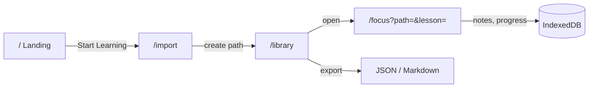

# FEATURE SPECIFICATION: PHASE 1A — LOCAL FOCUS ROOM

**Specification ID:** SPEC-0002
**Feature:** URL import, Focus Room, timestamped notes, progress, local export — no backend
**Status:** Draft
**Target Routes:** `/import`, `/library`, `/focus`
**Primary Owner:** Frontend Engineering (`@SriSatyaLokesh`, `@scc4287`)
**Parent Documents:** [`docs/OPENLEARN_PRD.md`](../../docs/OPENLEARN_PRD.md) §11, §15, §16, §18, §19 · [`docs/ARCHITECTURE.md`](../../docs/ARCHITECTURE.md) §6, §8, §9, §11, §17
**Governing ADRs:** [0005](../../docs/ADR/0005-repo-structure.md) · [0006](../../docs/ADR/0006-youtube-provider-contract.md) · [0009](../../docs/ADR/0009-pwa-and-offline.md) · [0011](../../docs/ADR/0011-nextjs-static-export-for-phase-1.md) · [0012](../../docs/ADR/0012-local-first-data-layer.md)
**Followed by:** [SPEC-0003](../phase-1b-accounts-sync/spec.md) (accounts and sync)

---

## 1. Objective & Scope

A visitor with no account and no credentials can paste YouTube links, study them in a distraction-free room, take timestamped Markdown notes, resume where they left off, and export everything. All data lives in the browser.

### 1.1 In scope

| Capability | PRD |
|---|---|
| Paste one or more YouTube video URLs (or text containing URLs) and create a path | §11, §19 |
| Local metadata resolution (title, channel) via oEmbed; duration from the player | §11 |
| Library of local paths with progress and last activity | §18 |
| Focus Room: embedded player, lesson list, resume, progress | §15 |
| Timestamped Markdown notes: create, edit, delete, click-to-seek, preview | §16 |
| Manual lesson completion with an end-of-video prompt | §18 |
| Per-path Markdown export and whole-database JSON export/restore | §19, D10 |
| Eviction warning and persistent-storage request | ADR 0012 |

### 1.2 Explicit non-goals

- **Accounts, server sync, Supabase.** → SPEC-0003.
- **Playlist import.** A playlist URL is detected and reported, not resolved (needs the Data API key and a server; ADR 0008).
- **Service worker and offline cold-start.** Deferred (ADR 0009 / D11). A web-app manifest is an optional stretch (AC-48).
- **Path Builder UI** (reorder, modules, concepts, alternatives), **course-level notes** (PRD §17), forking, publishing, gamification, search, public pages.
- **Background or audio-only playback; offline video.** Prohibited by YouTube policy (ARCHITECTURE §18.5).

---

## 2. Information Architecture



### 2.1 Routes (static export, ADR 0011)

| Route | Purpose | Indexed |
|---|---|---|
| `/` | Landing (SPEC-0001); CTAs retargeted to `/import` and `/library` | Yes |
| `/import/` | Paste URLs, preview parsed items, confirm | No |
| `/library/` | Paths, progress, rename, delete, export, storage warning | No |
| `/focus/?path=<id>&lesson=<conceptId>` | Focus Room | No |

Each app route is a client component reading `useSearchParams()` inside `<Suspense>`. A missing or unknown `path` renders an explicit "path not found" state with a link to `/library`.

### 2.2 Code architecture (ADR 0005, adapted by ADR 0011)

```text
src/
├── app/
│   ├── import/page.tsx
│   ├── library/page.tsx
│   └── focus/page.tsx
├── components/
│   ├── focus/        PlayerHost, LessonList, NotesPanel, CompletionPrompt, ResponsiveShell
│   ├── import/       UrlPasteBox, ParsePreview
│   └── library/      PathCard, StorageNotice, ExportMenu
└── modules/                    # framework-free; only index.ts is importable
    ├── youtube/     parse(), resolveOEmbed(), formatTimestamp(), buildWatchUrl()
    ├── learning/    entities, createPathFromRefs(), orderKeyAfter(), completion rules, repository ports
    ├── notes/       Note model, markdown export, sanitiser config, repository port
    ├── storage/     Dexie schema + migrations, repository implementations, export/restore
    └── shared/      Result type, ids (UUIDv7), clock
```

**Dependency direction:** `components → modules`; `storage → learning, notes` (implements their ports); `learning`/`notes` never import `storage`. No `react`/`next` imports inside `modules/` (lint-enforced, AC-1).

### 2.3 Focus Room layout

Constrained by YouTube policy (ARCHITECTURE §9.1, §18.4), not taste.

```text
Desktop ≥ 1024px                      Phone < 1024px
┌───────────────────┬────────────┐    ┌──────────────────────┐
│   PLAYER (16:9)   │ Lessons    │    │ PLAYER (pinned 16:9) │
│                   │ ○ ✓ ▶ ...  │    ├──────────────────────┤
├───────────────────┤            │    │ Notes | Lessons      │ sticky tabs
│ Notes panel       │            │    ├──────────────────────┤
└───────────────────┴────────────┘    │ scrollable panel     │
                                      └──────────────────────┘
```

- **One persistent player** per page, created once; lesson changes call `loadVideoById` on the same player.
- **Panels switch by CSS visibility**, never by unmounting the player.
- **Sheets and prompts push content; they never overlay the player.** The completion prompt renders below it.
- `env(safe-area-inset-*)` padding on the pinned layout.

---

## 3. Behaviour Specification

### 3.1 Import and parsing (`modules/youtube`)

`parse(input: string): ParseResult` is **pure and network-free**.

1. Extract every URL-like token from arbitrary pasted text.
2. Recognise `youtube.com/watch?v=`, `youtu.be/`, `youtube.com/shorts/`, `youtube.com/embed/`, `m.youtube.com`, `music.youtube.com`, ignoring extra params (`t`, `si`, `feature`, …).
3. A valid video id matches `^[A-Za-z0-9_-]{11}$`. Anything else is a per-item failure.
4. A URL with `list=` and no `v=` is classified `playlist` → "Playlist import arrives with accounts" (not an error state).
5. Non-YouTube URLs are listed as `unsupported`.
6. **Dedupe by video id; preserve first-seen order.**
7. Never fetch a user-supplied URL. The only network call is oEmbed, built by *our* code from a validated id.

`resolveOEmbed(videoId)` calls `https://www.youtube.com/oembed?url=<watch-url>&format=json`. Outcomes: `ok{title, channelName}` · `notFound` (404: private/deleted) · `notEmbeddable` (401/403) · `networkError`. A failure never blocks import of the other items; a `networkError` item is imported with a placeholder title and re-resolved on next library load.

**Gate (spike, before build):** verify oEmbed permits browser CORS. **Fallback if not:** import without metadata and fill `title`/`durationSeconds` from `player.getVideoData()` on first play.

### 3.2 Domain model (`modules/learning`, `modules/notes`)

The **full hierarchy** is stored from day one (D6) so Phase 2 adds UI only. Import auto-flattens: **one implicit Module, one Concept per video, one `primary` Resource per Concept**. The UI shows a flat lesson list.

### 3.3 Persistence ladder (ARCHITECTURE §9)

`player position (memory)` → **IndexedDB every ~10 s while playing** → **immediate flush** on pause, `visibilitychange` (hidden), and `pagehide`. Worst-case loss on a crash is ~10 s. Position writes touch only `resourceProgress`.

### 3.4 Completion (D8)

Completion is a deliberate learner action. At the `ended` event or at ≥ `COMPLETION_PROMPT_THRESHOLD` (0.9) of duration, a **non-blocking** prompt below the player offers "Mark lesson complete". Nothing completes without confirmation. "Mark complete" is also always available manually, and is undoable. There is no auto-complete and no raw-watch-time rule (YouTube policy; ARCHITECTURE §11–12).

### 3.5 Notes (D9)

- A note stores `timestampSeconds` (integer), `contentMarkdown`, and anchors (`resourceId`, `conceptId`, `pathId`). `conceptId` is required so notes survive a future switch to an alternative explanation.
- **Add note** captures the current player position at click. It does not force a pause.
- **Editor:** `<textarea>` with a preview pane. Stored format is plain Markdown.
- **Renderer:** `react-markdown` with **raw HTML disabled** plus `rehype-sanitize`. Links allow `http`, `https`, `mailto` only and render `rel="noopener noreferrer"` `target="_blank"`. Images are not rendered in Phase 1.
- Clicking a note's timestamp seeks the player to `timestampSeconds`.
- Saves are debounced (~500 ms) and flushed on blur and `pagehide`.

### 3.6 Resume

On opening a lesson, the player starts at `lastPositionSeconds` (clamped to duration; ≥ 95% treated as start). **Resume uses `lastPositionSeconds`; `furthestPositionSeconds` is stored for Slice B** (ADR 0012; see OQ-1).

### 3.7 Export, restore, eviction

- **Per-path Markdown export:** notes grouped by lesson in path order, each timestamp rendered as `[18:37](https://youtu.be/<id>?t=1117)`.
- **Whole-database JSON export** with a `schemaVersion`, and **restore** that merges by id (idempotent union, never overwriting a newer `updatedAt`).
- On first save, call `navigator.storage.persist()` and show a dismissible notice: "Your learning lives in this browser until you save it to an account. Export a backup." (PRD §19 wording to be finalised with product.)

### 3.8 30-day metadata rule (ARCHITECTURE §8.4, C8)

`video.lastSyncedAt` records when descriptive fields were fetched. On library load, any video with `lastSyncedAt` older than 30 days is re-resolved via oEmbed in the background; if it returns `notFound`, the resource is marked `unavailable` and shown with a broken-state affordance, not removed. This is best-effort in 1A (see OQ-3).

---

## 4. Data Contracts & Schemas

All entities extend the sync-ready envelope from ADR 0012. Ids are UUIDv7, generated client-side.

```ts
interface RowEnvelope {
  id: string;
  createdAt: number;          // epoch ms
  updatedAt: number;          // bumped on every local write
  deletedAt: number | null;   // soft delete
}

interface Video extends RowEnvelope {
  provider: 'youtube';
  providerVideoId: string;    // 11 chars
  title: string | null;       // null until resolved
  channelName: string | null;
  durationSeconds: number | null; // from the player on first load
  embeddable: boolean | null;
  lastSyncedAt: number | null;
  health: 'ok' | 'unavailable' | 'unknown';
}

interface Path extends RowEnvelope { title: string; description: string; publicCode: string | null; } // publicCode unused in 1A
interface Module extends RowEnvelope { pathId: string; title: string; orderKey: string; }
interface Concept extends RowEnvelope { moduleId: string; pathId: string; title: string; orderKey: string; }
interface Resource extends RowEnvelope {
  conceptId: string; videoId: string;
  kind: 'primary' | 'alternative'; orderKey: string;
}

interface ConceptProgress extends RowEnvelope {
  pathId: string; conceptId: string;
  status: 'not_started' | 'in_progress' | 'completed';
  activeResourceId: string; completedAt: number | null;
}
interface ResourceProgress extends RowEnvelope {
  resourceId: string;
  lastPositionSeconds: number;      // resume target
  furthestPositionSeconds: number;  // monotonic; merged with GREATEST in 1B
}

interface Note extends RowEnvelope {
  pathId: string; conceptId: string; resourceId: string;
  timestampSeconds: number;         // integer ≥ 0
  contentMarkdown: string;
}
```

**Ordering** uses fractional `orderKey` strings (ARCHITECTURE §6.4). 1A only appends, via `orderKeyAfter(lastKey)`; the helper must support `between(a, b)` so Phase 2 reordering needs no migration.

**Dexie schema v1** indexes: `video[providerVideoId]`, `path[updatedAt]`, `module[pathId+orderKey]`, `concept[pathId+orderKey]`, `resource[conceptId+orderKey]`, `conceptProgress[pathId+conceptId]`, `resourceProgress[resourceId]`, `note[conceptId+timestampSeconds]`, `note[pathId]`. Soft-deleted rows are excluded by the repository layer, never by callers.

**Repository ports** (in `learning`/`notes`; implemented in `storage`) return `Result<T, StorageError>` and are the only data access React components use.

**Progress** (`percentComplete`) is computed on read from `conceptProgress` (completed ÷ non-deleted concepts). No stored rollup in 1A.

---

## 5. Design Tokens & Accessibility

Reuses the TasteSkill tokens from SPEC-0001 (paper `#F5F4F0`, charcoal, accent `#FF5226`; Outfit / Newsreader / JetBrains Mono). The Focus Room favours calm contrast; the accent is reserved for the active lesson and primary actions.

### 5.1 Policy-driven constraints (testable)

- Player viewport ≥ **200×200 px** at every breakpoint, including 360 px wide.
- No element overlaps the player's bounding box at any time.
- Player controls are YouTube's own; they are never hidden or replaced.
- No autoplay with sound; no background/audio-only mode.
- Copy never rewards or refers to *watching*; use *complete / learn*. Use "**Ad-free OpenLearn interface**", never a claim of suppressing YouTube's ads (PRD §40).

### 5.2 Accessibility (WCAG 2.2 AA)

Semantic landmarks; visible focus states; full keyboard operation of import, library, lesson list, notes and completion; labelled form controls; `aria-live` (polite) announcements for import results and "note saved"; `prefers-reduced-motion` respected; contrast ≥ AA; every actionable element reachable at 360 px.

---

## 6. SEO / AEO / GEO

App routes are `noindex, nofollow` via route metadata and excluded from any sitemap. Only `/` is indexed (SPEC-0001, unchanged). No structured data is added in 1A.

---

## 7. Acceptance Criteria

Each AC names its verifying layer: **U** = Vitest unit · **D** = Vitest + `fake-indexeddb` · **E** = Playwright (YouTube player replaced by a test double) · **A** = axe/automated a11y · **M** = manual.

### Tooling and structure
- [ ] **AC-1 (U/lint)** ESLint flat config fails on a deep import across `modules/*` and on any `react`/`next` import inside `modules/`.
- [ ] **AC-2** `next build` with `output: 'export'`, `tsc --noEmit`, and lint pass with zero errors in CI on every PR.
- [ ] **AC-3** `src/app/*` routes build as static files; no route handlers or server actions exist.
- [ ] **AC-4** A GitHub Actions workflow runs lint, typecheck, Vitest, build and Playwright, and is required for merge.

### Import and parsing
- [ ] **AC-5 (U)** `parse()` extracts ids from all listed URL forms, ignoring extra params, with fixtures per form.
- [ ] **AC-6 (U)** Pasted prose containing several URLs yields all of them, deduped, in first-seen order.
- [ ] **AC-7 (U)** Invalid ids, non-YouTube URLs and playlist-only URLs are classified `invalid` / `unsupported` / `playlist` respectively and never throw.
- [ ] **AC-8 (U)** `parse()` performs no network access (test fails if `fetch` is called).
- [ ] **AC-9 (U)** The oEmbed client maps 200/404/401/403/network failure to `ok/notFound/notEmbeddable/networkError`.
- [ ] **AC-10 (E)** Importing a mix of good, bad and playlist links shows a per-item result list and creates a path from the good ones only.
- [ ] **AC-11 (E)** A `networkError` item is imported with a placeholder title and re-resolved on the next library load.
- [ ] **AC-12 (M, gate)** oEmbed browser-CORS behaviour verified before implementation; fallback path chosen and recorded in this spec.

### Domain model and persistence
- [ ] **AC-13 (D)** Importing N videos creates exactly 1 Path, 1 Module, N Concepts, N primary Resources, with strictly increasing `orderKey`s.
- [ ] **AC-14 (U)** `orderKeyBetween(a, b)` returns a key strictly between `a` and `b` for 10,000 random insertions.
- [ ] **AC-15 (D)** Every entity carries `id` (UUIDv7), `createdAt`, `updatedAt`, `deletedAt`; `updatedAt` increases on each write.
- [ ] **AC-16 (D)** Soft-deleted rows are never returned by any repository read.
- [ ] **AC-17 (D)** Each Dexie `version(n)` upgrade is tested against a fixture of the prior version; the v1 baseline fixture is committed.
- [ ] **AC-18 (E)** A created path, its notes and its progress survive a full page reload.
- [ ] **AC-19 (D)** Repository calls return `Result`; a simulated quota/blocked-storage error surfaces a visible, non-crashing error state.

### Library
- [ ] **AC-20 (E)** `/library` lists paths with title, lesson count, `percentComplete` and last activity; rename and delete (soft) work and persist.
- [ ] **AC-21 (E)** An empty library shows an empty state linking to `/import`.
- [ ] **AC-22 (E)** An unknown `path` id in `/focus` shows "path not found" with a link back, not a crash.

### Focus Room — player and layout
- [ ] **AC-23 (E)** Opening `/focus?path=…` renders one player and the lesson list; the active lesson is marked.
- [ ] **AC-24 (E)** Switching lessons and switching Notes/Lessons tabs does **not** recreate the player (asserted via a creation counter in the test double).
- [ ] **AC-25 (E)** At 360×740 and 1280×800 the player's rendered box is ≥ 200×200.
- [ ] **AC-26 (E)** At 360×740, opening any sheet, tab or prompt leaves the player's bounding box unobstructed (no overlapping element).
- [ ] **AC-27 (E)** Under React Strict Mode in dev, exactly one player instance is live after mount.
- [ ] **AC-28 (M)** On a real iOS Safari and Android Chrome device, pinned layout clears safe areas and the player is never covered.

### Resume and persistence ladder
- [ ] **AC-29 (D/E)** While playing, position is written about every 10 s (±2 s) to `resourceProgress` only.
- [ ] **AC-30 (E)** Pausing, hiding the tab (`visibilitychange`) and `pagehide` each flush position immediately.
- [ ] **AC-31 (E)** Reopening a lesson seeks to `lastPositionSeconds`; a position ≥ 95% of duration restarts at 0.
- [ ] **AC-32 (D)** `furthestPositionSeconds` never decreases across any sequence of writes.
- [ ] **AC-33 (E)** Duration observed from the player on first load is saved to `video.durationSeconds`.

### Completion
- [ ] **AC-34 (E)** At `ended` or ≥ 90% of duration, a non-blocking completion prompt appears below the player and does not complete anything by itself.
- [ ] **AC-35 (E)** Confirming marks the concept `completed` with `completedAt`, updates progress %, and persists across reload.
- [ ] **AC-36 (E)** A completed lesson can be un-completed; progress % reverts.
- [ ] **AC-37 (U)** No code path completes a concept from playback position alone (completion function requires an explicit user-action source).

### Notes
- [ ] **AC-38 (E)** "Add note" records the current player second as an integer; the note appears in timestamp order.
- [ ] **AC-39 (E)** Clicking a note's timestamp seeks the player to that second.
- [ ] **AC-40 (E)** Notes can be edited and soft-deleted; changes persist after reload.
- [ ] **AC-41 (U/E)** Markdown preview strips `<script>`, event-handler attributes, `javascript:` links and raw HTML; images are not rendered; links open with `rel="noopener noreferrer"`.
- [ ] **AC-42 (U)** `formatTimestamp(1117)` → `18:37`; hours format as `1:02:03`.

### Export, restore, storage
- [ ] **AC-43 (U)** Per-path Markdown export groups notes by lesson in path order and renders each timestamp as a `youtu.be/<id>?t=<s>` link.
- [ ] **AC-44 (D)** JSON export contains `schemaVersion` and all non-deleted rows; restoring it into an empty database reproduces them with identical ids.
- [ ] **AC-45 (D)** Restoring into a populated database is an idempotent union and never overwrites a row with a newer `updatedAt`.
- [ ] **AC-46 (E)** `navigator.storage.persist()` is requested on first save, and the dismissible eviction notice is shown until dismissed.
- [ ] **AC-47 (D/E)** A video with `lastSyncedAt` older than 30 days is re-resolved on library load; a `notFound` result marks the resource `unavailable` without deleting it.
- [ ] **AC-48 (optional, stretch)** A web-app manifest and icons make the app installable. Not required for `Implemented`.

### Accessibility and policy
- [ ] **AC-49 (A)** axe reports no serious or critical violations on `/import`, `/library`, `/focus`.
- [ ] **AC-50 (E)** Import, lesson selection, add-note, complete, and export are fully operable by keyboard alone.
- [ ] **AC-51 (M)** NVDA and VoiceOver pass for import results, lesson list and notes.
- [ ] **AC-52** `prefers-reduced-motion` disables non-essential animation.
- [ ] **AC-53** App routes emit `noindex, nofollow`; landing CTAs route to `/import` / `/library`.
- [ ] **AC-54** UI copy contains no reward/incentive language about *watching*, and "Ad-free OpenLearn interface" is the only ad-related claim (review checklist).

### Baselines for the Phase 2 gate (ADR 0011)
- [ ] **AC-55** CI records the Focus Room JS payload (gzip) and a Lighthouse mobile score, stored as a build artifact.

---

## 8. Open Questions

- **OQ-1 Resume semantics.** `lastPositionSeconds` (where the learner stopped) vs `furthestPositionSeconds` (ARCHITECTURE §18.3's `GREATEST`). This spec resumes from `last`. Confirm with product; if `furthest` is wanted, §18.3 is right as written and the extra field is simply unused.
- **OQ-2 oEmbed CORS.** AC-12 gate; fallback defined in §3.1.
- **OQ-3 30-day rule for locally cached metadata.** Whether client-side caching of oEmbed fields falls under YouTube's retention clause is an interpretation (ARCHITECTURE §24 #3). §3.8 takes the conservative reading.
- **OQ-4 Eviction wording.** Final copy for the persistence notice and the PRD §19 "Save your learning journey" tie-in.
- **OQ-5 Test double for the player.** Define the fake `YT.Player` contract (events, `getCurrentTime`, `seekTo`, `loadVideoById`, creation counter) once, in `tests/`, so AC-24/27/29–31 share it.
- **OQ-6 New dependencies to approve:** `dexie`, `dexie-react-hooks`, `uuidv7`, `react-markdown`, `rehype-sanitize`, `vitest`, `fake-indexeddb`, `@playwright/test`, `@axe-core/playwright`, `eslint` + plugins, and an ordering helper (`fractional-indexing` or in-house).

---

## 9. Delivery Order (suggested, for the plan phase)

1. Tooling: ESLint boundaries, Vitest, CI, `output: 'export'` (AC-1–4).
2. `youtube` + `shared` modules and oEmbed spike (AC-5–9, 12).
3. `storage` + `learning` + `notes` models and migrations (AC-13–19).
4. Import and Library UI (AC-10, 11, 20–22).
5. Focus Room: player host, layout, resume, completion (AC-23–37).
6. Notes UI and export/restore (AC-38–47).
7. Accessibility, policy checks, baselines (AC-49–55).
